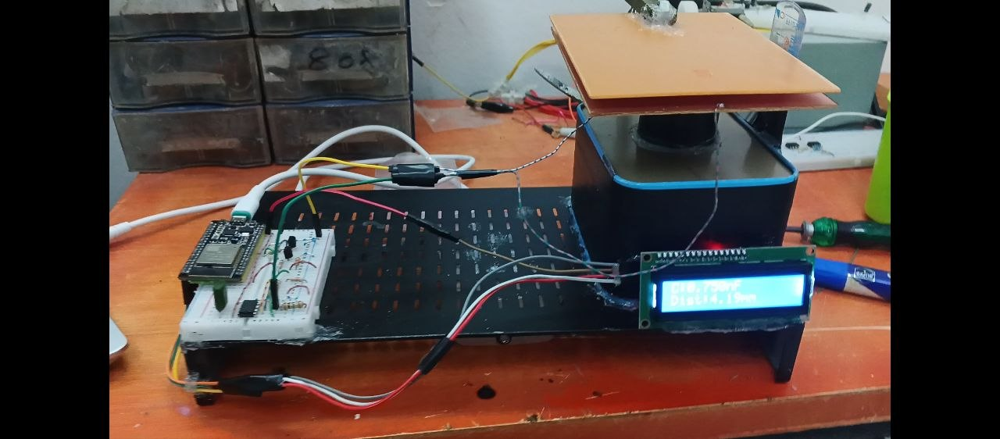
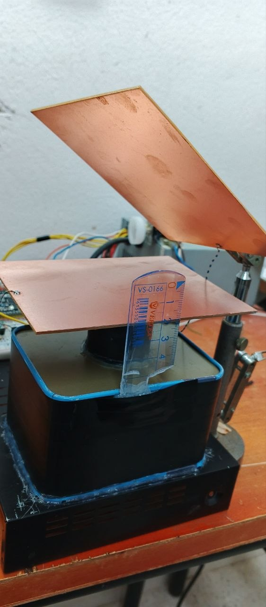
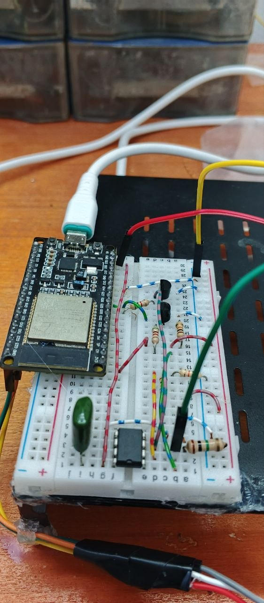

# Contactless Capacitive Displacement Sensor

**Design, Implementation, and Experimental Characterization of an RC-Based Capacitive Displacement Measurement System**

<p align="center">
  
</p>

<p align="center">
  
  
  
  
  
</p>

## 1. Project Overview

This project presents the design and experimental implementation of a **contactless capacitive displacement sensor** based on the variation of capacitance between two parallel conductive plates.

The sensing element consists of two PCB electrodes, one fixed and one movable. Displacement changes the separation between the electrodes, resulting in a variation in capacitance.

The measured capacitance is converted into a time interval through an RC charging circuit. An LM358 operational amplifier is used as a threshold detector, while two C1815 NPN transistors handle capacitor discharge and signal interfacing. An ESP32 measures the threshold-crossing time and processes the measurement to estimate displacement.

The estimated capacitance and displacement are displayed on a 16×2 I2C LCD, while measurement data are also transmitted through the Serial Monitor.

The project focuses on developing a low-cost analog measurement interface and evaluating its performance through experimental measurements and comparison with a digital multimeter.

## 2. Project Objectives

The main objectives are:

- Design and fabricate a capacitive sensing element using PCB electrodes.
- Develop an analog RC interface for capacitance measurement.
- Implement threshold detection using an LM358.
- Measure the RC charging time using an ESP32.
- Convert measured capacitance into displacement through calibration.
- Implement a piecewise cubic calibration function.
- Display capacitance and displacement on an I2C LCD.
- Investigate the influence of charging resistance on measurement performance.
- Compare the electronic measurement system against a digital multimeter.
- Evaluate sensitivity, repeatability, resolution, and measurement error.

## 3. Operating Principle

### 3.1 Capacitive Sensing Principle

The sensing element operates on the principle of a parallel-plate capacitor.

Its capacitance is approximately described by:

$$
C = \frac{\varepsilon_0 \varepsilon_r A}{d}
$$

Where:

- $C$: Capacitance (F).
- $\varepsilon_0$: Vacuum permittivity.
- $\varepsilon_r$: Relative permittivity of the dielectric.
- $A$: Effective overlapping electrode area (m²).
- $d$: Distance between the electrodes (m).

For an air dielectric, $\varepsilon_r \approx 1$.

As the distance between the electrodes increases, capacitance decreases. Conversely, reducing the distance increases capacitance.

### 3.2 RC Time Measurement

The capacitance is measured indirectly using an RC charging circuit.

The capacitor voltage during charging is:

$$
V_C(t)=V_S\left(1-e^{-t/RC}\right)
$$

The time constant is:

$$
\tau=RC
$$

When the capacitor voltage reaches half of the supply voltage:

$$
V_C(t)=\frac{V_S}{2}
$$

The corresponding charging time is:

$$
t=RC\ln(2)
$$

Therefore, the capacitance can be estimated using:

$$
C=\frac{t}{R\ln(2)}
$$

The ESP32 measures the time required for the sensor voltage to cross the reference threshold. This time is then used to calculate the capacitance.

### 3.3 Measurement Sequence

1. The sensor capacitor is discharged through Q2.
2. Q2 is switched OFF to initiate capacitor charging.
3. The capacitor voltage increases through the charging resistor.
4. The LM358 detects when the voltage crosses the reference threshold.
5. Q1 provides a logic-compatible signal to the ESP32.
6. The ESP32 measures the elapsed time and calculates capacitance.
7. A calibration function converts capacitance into displacement.
8. The capacitance and estimated displacement are displayed on the LCD and Serial Monitor.

## 4. System Architecture

<p align="center">
  
</p>

The system is divided into five main functional blocks:

| Block | Function |
|---|---|
| Capacitive Sensor | Converts mechanical displacement into capacitance variation. |
| RC Interface | Converts capacitance into a charging-time variation. |
| Threshold Detector | Detects the reference-voltage crossing using LM358. |
| Switching and Signal Interface | Controls capacitor discharge and interfaces the detection signal. |
| Digital Processing and Display | Measures time, calculates capacitance, estimates displacement, and displays the results. |

## 5. Hardware Implementation

### 5.1 Main Components

| Component | Description |
|---|---|
| ESP32-WROOM-32 | Measurement, timing, and data processing |
| LM358 | Analog threshold detection |
| 2 × C1815 | NPN switching transistors |
| PCB Electrodes | Capacitive sensing element |
| 100 kΩ resistor | Initial RC charging resistance |
| 10 kΩ resistors | Reference-voltage divider and signal pull-up |
| 4.7 kΩ resistors | Transistor base resistors |
| 100 nF capacitor | Supply decoupling |
| 16×2 I2C LCD | Capacitance and displacement display |
| 5 V supply | LM358 power supply |

### 5.2 Capacitive Sensor

The sensing element consists of two rectangular PCB electrodes.

- Electrode dimensions: **10 cm × 12.5 cm**.
- Electrode configuration: Parallel conductive plates.
- Dielectric: Air.
- Mechanical configuration: One fixed electrode and one movable electrode.

<p align="center">
  
</p>

*Figure: Fabricated PCB electrodes used as the capacitive sensing element.*

### 5.3 Electronic Circuit

<p align="center">
  
</p>

The initial electronic implementation uses an LM358-based threshold detection circuit.

The ESP32 controls the discharge transistor through GPIO26 and reads the detection signal through GPIO27.

| ESP32 Pin | Connection | Function |
|---|---|---|
| GPIO26 | Q2 base through 4.7 kΩ | Capacitor discharge control |
| GPIO27 | Q1 collector | Threshold detection input |
| GPIO21 | LCD SDA | I2C data |
| GPIO22 | LCD SCL | I2C clock |
| 3.3 V | Sensor charging resistor and pull-up | Logic-compatible supply |
| GND | Common ground | Circuit reference |

**Power supply considerations:**

- LM358 is powered from 5 V.
- ESP32 GPIO pins operate at 3.3 V logic.
- The sensor charging node and GPIO pull-up must remain compatible with the ESP32 input voltage.
- All circuit grounds must be connected together.

### 5.4 LCD Interface

A 16×2 I2C LCD is used to display the measurement results.

The LCD is connected to the ESP32 using the I2C communication interface.

| LCD Pin | ESP32 Connection |
|---|---|
| SDA | GPIO21 |
| SCL | GPIO22 |
| VCC | LCD supply |
| GND | Common ground |

The firmware uses the I2C address `0x27`:

```cpp
LiquidCrystal_I2C lcd(0x27, 16, 2);
```

The LCD displays:

- First row: Measured capacitance in nF.
- Second row: Estimated displacement in mm.

Example display:

```text
C:0.765nF
Dist:4.00mm
```

If the threshold is not detected within the measurement timeout, the LCD displays a timeout message.

<p align="center">
  
</p>

*Figure: LCD displaying the measured capacitance and estimated displacement.*

## 6. Experimental Characterization

Experimental characterization was performed to investigate the relationship between electrode displacement and measured capacitance.

Two measurement methods were considered:

1. The developed electronic measurement circuit.
2. A digital multimeter used as a reference instrument.

The capacitance was recorded at different electrode positions while maintaining the same mechanical configuration.

### 6.1 Electronic Circuit vs. Digital Multimeter

<p align="center">
  
</p>

*Figure: Experimental comparison of capacitance measurements obtained using the developed circuit and a digital multimeter.*

The experimental results demonstrate a decreasing capacitance as electrode separation increases.

The electronic circuit successfully detects displacement-related capacitance variations. However, differences in measured capacitance values and measurement resolution remain under investigation.

### 6.2 Charging Resistance Investigation

The charging resistance directly influences the RC charging time:

$$
t=0.693RC
$$

Increasing the resistance increases the measured charging time for a given capacitance. This can improve the practical timing resolution, although excessively high resistance may increase sensitivity to leakage currents, noise, and parasitic effects.

Experiments will be conducted using different charging resistances to evaluate their influence on measurement performance.

<p align="center">
  
</p>

*Figure: Capacitance or charging-time response obtained using different RC charging resistances.*

**Experimental configurations:**

| Configuration | Charging Resistance | Status |
|---|---:|---|
| R1 | 100 kΩ | Initial implementation |
| R2 | 1 MΩ | To be evaluated |
| R3 | 4.7 MΩ | To be evaluated |
| R4 | 10 MΩ | To be evaluated |

*Only experimentally tested configurations should be reported as measured results.*

### 6.3 Calibration

The relationship between capacitance and displacement is not assumed to be perfectly linear.

A calibration procedure is therefore used to map measured capacitance values to known mechanical positions.

<p align="center">
  
</p>

*Figure: Calibration curve relating measured capacitance to electrode displacement.*

The current firmware implements a **PCHIP-style piecewise cubic interpolation function** to estimate displacement from measured capacitance.

The function `calculateDistance()` receives capacitance in nF and returns displacement in mm.

The capacitance range is divided into several intervals, with a cubic polynomial assigned to each interval:

$$
d(x)=a_ix^3+b_ix^2+c_ix+e_i
$$

Where:

- $x$: Measured capacitance (nF).
- $d(x)$: Estimated displacement (mm).
- $a_i,b_i,c_i,e_i$: Polynomial coefficients for the corresponding interval.

The current calibration breakpoints are:

| Capacitance (nF) | Displacement (mm) |
|---:|---:|
| 0.577 | 11 |
| 0.592 | 10 |
| 0.606 | 9 |
| 0.620 | 8 |
| 0.635 | 7 |
| 0.664 | 6 |
| 0.692 | 5 |
| 0.765 | 4 |
| 0.837 | 3 |
| 0.981 | 2 |

For measurements outside this calibrated range, the current firmware returns the corresponding endpoint distance rather than extrapolating the polynomial.

## 7. Measurement Performance Evaluation

The system will be evaluated using the following performance indicators:

| Parameter | Purpose |
|---|---|
| Sensitivity | Change in capacitance per unit displacement |
| Resolution | Smallest detectable displacement variation |
| Repeatability | Consistency across repeated measurements |
| Linearity | Deviation from an ideal linear response |
| Accuracy | Agreement with reference measurements |
| Measurement Error | Difference between measured and reference values |

For a selected displacement interval, sensitivity can be estimated as:

$$
S=\frac{\Delta C}{\Delta d}
$$

The relative error with respect to the reference instrument can be calculated as:

$$
\text{Relative Error}(\%)=
\frac{|C_{\text{circuit}}-C_{\text{reference}}|}
{C_{\text{reference}}}\times100
$$

## 8. Software Implementation

The ESP32 firmware is developed using the Arduino framework.

The firmware performs:

- Capacitor discharge control.
- RC charging-time measurement.
- Threshold-crossing detection.
- Capacitance calculation.
- Displacement estimation through piecewise cubic calibration.
- LCD measurement display.
- Serial data output.

The measurement sequence is repeated periodically to provide continuous sensor monitoring.

### 8.1 Libraries

```cpp
#include <Wire.h>
#include <LiquidCrystal_I2C.h>
```

### 8.2 Measurement Parameters

The current firmware uses the following parameters:

| Parameter | Value | Purpose |
|---|---:|---|
| Charging resistance | 100 kΩ | Controls capacitor charging |
| Threshold factor | 0.693147 | Corresponds to ln(2) |
| Discharge duration | 1000 µs | Resets sensor capacitor |
| Measurement timeout | 1,000,000 µs | Maximum threshold waiting time |
| Measurement interval | 500 ms | Delay between measurement cycles |
| Serial baud rate | 115200 | Serial communication |

### 8.3 Capacitance Calculation

The elapsed time is converted into seconds:

$$
t_s=t_{\mu s}\times10^{-6}
$$

The capacitance is calculated using:

$$
C_F=\frac{t_s}{0.693147R}
$$

The result is converted into nanofarads:

$$
C_{nF}=C_F\times10^9
$$

The calculated capacitance is subsequently passed to the calibration function:

```cpp
float distance_mm = calculateDistance(capacitance_nF);
```

### 8.4 Output

The Serial Monitor displays the measured capacitance, charging time, and estimated displacement.

Example:

```text
C = 0.765 nF | t = ... us | Distance = 4.00 mm
```

The LCD displays the capacitance and estimated distance.

If no threshold transition is detected within the timeout period, the firmware reports a timeout through the Serial Monitor and LCD.

<p align="center">
  
</p>

## 9. Repository Structure

The repository is organized as follows:

```text
capacitive-displacement-sensor/
│
├── README.md
│
├── docs/
│   ├── report/
│   │   └── project-report.pdf
│   │
│   ├── images/
│   │   ├── project-banner.png
│   │   ├── sensor-electrodes.jpg
│   │   ├── system-block-diagram.png
│   │   ├── electronic-circuit.png
│   │   ├── lcd-display.jpg
│   │   ├── capacitance-comparison.png
│   │   ├── resistance-comparison.png
│   │   ├── calibration-curve.png
│   │   └── serial-monitor.png
│   │
│   └── schematics/
│       ├── circuit-schematic.pdf
│       └── circuit-schematic.png
│
├── firmware/
│   ├── capacitive_sensor/
│   │   └── capacitive_sensor.ino
│   │
│   └── calibration/
│       └── calibration.ino
│
├── experiments/
│   ├── raw-data/
│   │   ├── rc_100k.csv
│   │   ├── rc_1M.csv
│   │   ├── rc_4.7M.csv
│   │   └── multimeter_reference.csv
│   │
│   ├── graphs/
│   │   ├── capacitance_vs_displacement.png
│   │   ├── resistance_comparison.png
│   │   └── measurement_error.png
│   │
│   └── analysis/
│       └── experimental_analysis.ipynb
│
└── hardware/
    ├── bill-of-materials.md
    ├── pcb-design/
    └── mechanical-design/
```

## 10. Limitations and Current Challenges

The initial implementation demonstrates the feasibility of RC-based capacitive displacement measurement. Several engineering challenges remain:

- Parasitic capacitance introduced by PCB tracks, wiring, and electronic components.
- Limited timing resolution when measuring short RC charging intervals.
- Comparator propagation delay and switching characteristics.
- Sensitivity to electrical noise and reference-voltage stability.
- Differences between the electronic circuit and multimeter measurements.
- Nonlinear capacitance-to-displacement conversion.
- Mechanical alignment and repeatability of the electrode spacing.

These limitations are being investigated through circuit modifications, resistance variation experiments, and calibration.

## 11. Future Improvements

Potential improvements include:

- Replacing the LM358 threshold detector with a dedicated comparator.
- Implementing hysteresis to improve switching stability.
- Investigating different RC charging resistances.
- Improving timing measurement using ESP32 hardware peripherals.
- Reducing parasitic capacitance through improved PCB layout and shielding.
- Investigating AC excitation and capacitance-to-frequency measurement techniques.
- Evaluating dedicated capacitance-to-digital converter ICs.
- Improving displacement calibration and measurement accuracy.
- Developing a dedicated PCB for the analog measurement interface.

## 12. Tools and Technologies

**Hardware**
- ESP32-WROOM-32
- LM358
- C1815 NPN transistors
- PCB capacitive electrodes
- 16×2 I2C LCD
- Analog electronic components

**Software and Design**
- Arduino IDE
- C/C++
- Python
- Kicad

## 13. Project Documentation

The detailed engineering report, experimental data, circuit schematics, and measurement graphs will be made available in the repository.

- [Project Report](docs/report/project-report.pdf)
- [Electronic Circuit Schematic](docs/schematics/circuit-schematic.pdf)
- [Experimental Results](experiments/graphs/)
- [Raw Measurement Data](experiments/raw-data/)

## 14. Author

**Abderraouf Brada**

Electronics and Sensors Engineering Student  
Interested in analog electronics, sensor systems, instrumentation, and robotics.

- GitHub: [abderraoufbrada](https://github.com/abderraoufbrada)
- LinkedIn: [Abderraouf Brada](https://www.linkedin.com/in/abderraouf-brada-16bab632a?utm_source=share_via&utm_content=profile&utm_medium=member_android)

---

*This project is an ongoing engineering development and experimental investigation. Measurements and performance claims are based on the documented experimental configurations and results.*
